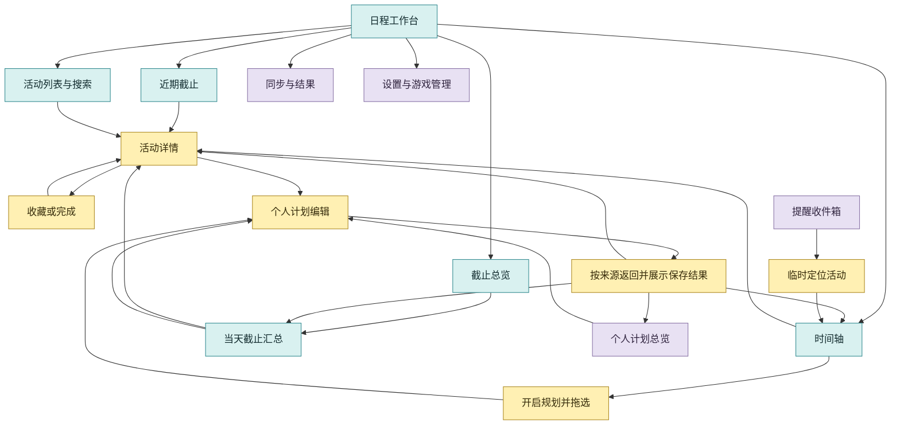

# 网页端交互规格草案

2026-11-13 实施说明：C1 与 C2 网页续作已落地，当前返回、草稿和定位规则及验收见 [网页任务往返](web-journey.md)。下文保留前期梳理，现状栏不代表修改后的行为。

作者 Codex，日期 2026-11-06。状态为网页侧梳理完成，已初步对照 Claude 的移动端提案；两份草案待合并确认，再分配实施任务。

本稿依据当前工作区源码、现有交互测试及所有者近期反馈编写。基线为 `V0.2.7`，包含工作区中的月历密度和触屏适配改动。下文分别列出现状、已确认的交互和建议规则，建议项仍需双方合并评审。

## 1. 用户任务与完成条件

| 编号 | 用户任务 | 入口 | 用户完成这件事时应看到的结果 |
| --- | --- | --- | --- |
| W01 | 看近期要截止的活动 | 日程中的近期截止 | 按当地截止时间排序的活动，可直接进入详情 |
| W02 | 比较多款游戏的周期 | 时间轴和游戏组合 | 同一日期尺上的活动周期，能识别所属游戏与预计时间 |
| W03 | 找截止集中的日期 | 截止总览 | 日期格填充与右下角数量，点击后列出当天截止项目 |
| W04 | 查找一个具体活动 | 搜索和活动列表 | 找到活动，或看懂哪个条件隐藏了它 |
| W05 | 标记感兴趣或已完成的活动 | 时间轴与活动详情 | 标记已保存，排序或显示结果有反馈，可以撤销 |
| W06 | 安排个人游玩时间 | 个人计划、活动详情、当天汇总 | 个人计划已保存，能看见时间及关联活动 |
| W07 | 查看提醒并回到活动 | 提醒收件箱 | 到达对应活动或目标日期，可回到原查看范围 |
| W08 | 更新资料或处理同步失败 | 同步资料和同步详情 | 看到各游戏的结果、缓存状态及下一步可做的操作 |
| W09 | 管理游戏和个人配置 | 游戏管理、设置、备份与恢复 | 清楚哪些改动已保存、何时生效，以及如何返回日程 |

网页的主要使用方式按鼠标、键盘和宽屏工作台梳理。窄屏浏览器和 APK 的页面安排由移动端规格一起评审。

## 2. 当前入口与页面职责

以下为当前代码中的有效入口。部分标签由 `navigation.js` 在启动时重新组织，应以运行后的职责核对。

| 区域 | 当前入口 | 职责 |
| --- | --- | --- |
| 主导航 | 日程、个人计划、游戏管理、设置 | 切换用户任务 |
| 页顶 | 显示时区、提醒、同步详情、同步资料 | 全局操作与状态 |
| 范围与筛选 | 游戏、组合、版本、类型、隐藏开关、排序、分组 | 确定查看的数据及排列方式 |
| 日历工具栏 | 日期导航、今天、日期全览、专注时间轴、四种视图 | 确定查看方式和日期范围 |
| 活动详情 | 头图、起止时间、收藏、完成、安排游玩 | 针对一个活动操作 |
| 当天汇总 | 截止节点、开放活动与计划 | 查看某一天的项目 |
| 设置 | 主题、布局、采集、备份与恢复 | 编辑偏好和管理数据 |

四种视图共用已选游戏和业务筛选，各自承担第 1 节的不同任务。视图之间切换时需要显示清楚当前范围和隐藏原因。

## 3. 页面与往返流程

蓝色为日常查看，黄色为针对条目的操作，紫色为管理与配置。箭头表示入口和返回关系。

关闭详情时恢复打开它的列表或汇总及原位置。保存计划后按进入编辑器的来源返回，提交结果同时更新各视图。浏览器后退键的具体映射见第 10 节待定项。

## 4. 现状与需要统一的规则

此表是代码路径检查，尚未逐项进行现场可用性验收。已有能力与后续提案分别记录。

| 观察 | 当前实现依据 | 需要梳理的结果 |
| --- | --- | --- |
| 页面入口已经按任务重新命名和组织 | `navigation.js` 的 `init()` | 在规格中固定主入口与职责，核对界面、提示及文档命名 |
| 详情会关闭其他功能弹窗 | `app.js` 的 `openEvent()` | 保存来源，关闭详情后回到原当天汇总或计划总览 |
| 计划编辑会关闭已打开的弹窗，普通保存后打开计划总览 | `planner.js` 的 `editor()`、`save()` | 活动、日期和计划列表三个来源分别定义保存与取消后的去向 |
| 切到月历会根据聚焦日期、显式日期或今天设置锚点 | `app.js` 的 `switchView()` | 明确各视图日期的继承及恢复规则 |
| 用户选择游戏时会重置搜索与日期，部分其他筛选继续存在 | `selectScope()` 及游戏选择的 change 处理 | 选定跨游戏的上下文策略，并给出一致反馈 |
| 搜索、类型等存在于当前网页状态，游戏组合和排序由工作区保存 | `S`、`WorkspaceService` | 页面临时状态与持久化偏好分别定义 |
| 临时定位可显示被筛选的目标活动，并可结束定位 | `locateEvent()`、`filteredEvents()` | 补齐定位前后的返回范围与目标失效时的处理 |
| 一部分表单需点击应用，一部分设置即时保存 | `customize.js`、`navigation.js` | 统一未保存提示、离开处理、成功与失败反馈 |
| 状态轮询已有写入计数、范围版本及日期意图保护 | `api()`、`refresh()`、`queueFocus()` | 把较晚响应的处理规则纳入用户流程验收 |
| 初始深链接可打开日期、活动和计划，部分参数随后被移除 | `applyState()`、`planner.query()` | 明确链接打开、刷新和浏览器返回的行为 |

## 5. 状态归属

| 状态 | 当前归属 | 建议规则 |
| --- | --- | --- |
| 官方活动、来源、精确或预计时间 | 后端活动缓存和投影 | 同步成功后更新，读取失败时使用已有缓存并显示失败原因 |
| 收藏、完成、备注、手动校正、个人计划 | 后端个人数据 | 服务端确认成功后显示已保存，失败时保留可继续操作的内容 |
| 游戏组合、排序、分组、隐藏未开放、共享聚焦 | 工作区 | 沿用共享持久化语义，显式操作后保存 |
| 主题、模块布局、提醒规则 | 后端偏好与工作区 | 各组明确标注即时保存或点击应用 |
| 搜索、类型勾选、日期窗口、滚动位置、专注显示 | 当前网页或浏览器本地状态，具体字段各有差异 | 分清本次查看与长期偏好，按来源记录返回位置 |
| 弹窗来源、返回目标、未提交草稿 | 多个模块中的局部变量 | 建立统一的导航上下文与草稿生命周期 |
| 正在保存、等待请求、同步阶段、局部报错 | 请求和任务状态 | 操作进行中给出反馈，结束后显示真实结果 |

导航上下文建议记录当前任务、视图、游戏范围、版本、日期范围、筛选快照、选中条目、滚动位置及触发控件。该结构的存放位置和跨端字段清单在双方合并评审时确定。

## 6. 主要操作规则

### 6.1 查看与范围

| 操作 | 建议行为 | 完成或返回位置 |
| --- | --- | --- |
| 切换四种视图 | 沿用当前游戏和筛选，按日期规则进入目标视图 | 显示目标视图及当前范围 |
| 今天 | 时间轴定位到今天，月历进入今天所在月，近期截止回到最近待截止位置 | 同一任务的日期位置 |
| 日期全览 | 根据筛选后的活动调整时间轴范围，跨度过大时给出实际展示方式 | 调整后的时间轴或活动列表 |
| 清除筛选 | 清除界面列明的条件，说明会恢复哪些隐藏项 | 当前视图和日期窗口 |
| 专注时间轴 | 临时收起周边模块，再次操作或 Esc 恢复 | 原模块布局及活动位置 |
| 点月历日期格 | 打开该日截止汇总，默认选中截止页签 | 关闭后回到原月份和格子 |
| 点个人计划标记 | 打开该日的开放活动与计划页签 | 关闭后回到原月份和标记 |
| 点时间轴的截止入口 | 查看该日截止汇总 | 关闭后回到时间轴的原位置 |
| 点普通时间轴日期 | 按时间尺阅读 | 规划模式下另有明确拖选提示 |

月历沿用所有者确认的呈现。所有截止日期使用同一种主题填充色，高度由本月峰值归一化计算，数量放在右下角，空格留白。今天使用整格宽的加粗提示线。截止计数按活动 ID 和 UTC 时刻去重，包含关闭阶段及兑换节点，同一活动可能在不同日出现截止节点。

### 6.2 活动操作

| 操作 | 保存与反馈 | 返回或恢复 |
| --- | --- | --- |
| 打开活动 | 详情即时打开，显示所属游戏、起止时间、来源及个人状态 | 记录来源视图或汇总 |
| 收藏 | 等待保存结果，更新收藏标记和排序 | 保持对应条目的操作焦点 |
| 完成 | 保存后更新列表与截止密度，提供撤销 | 条目因筛选消失时，提供可达的撤销入口 |
| 拖动排序 | 拿起和放下之间为预览，松开后提交 | 失败恢复原顺序，成功可撤销 |
| 手动校正与备注 | 保留原输入，显示校验或保存结果 | 未保存离开时按草稿规则处理 |
| 从汇总进入详情 | 保留日期、页签、滚动位置和原触发条目 | 关闭详情后恢复该汇总 |

### 6.3 个人计划

| 来源 | 创建时的上下文 | 建议保存后的去向 |
| --- | --- | --- |
| 个人计划总览 | 新建或已有计划 | 原计划总览，定位新增或更新的计划 |
| 时间轴拖选 | 选中时段和显示时区 | 原时间轴，显示新计划条 |
| 活动详情中的安排游玩 | 活动与游戏关联 | 原活动详情，反馈计划已保存并提供查看入口 |
| 当天汇总中的安排游玩 | 选中日期和显示时区 | 原当天汇总的计划页签，定位新计划 |

未保存的计划属于草稿。取消时恢复来源，保存失败时保留输入供重试。改变计划时区、跨夏令时和移动整段计划沿用现有时间解释规则，并在确认前让用户看到实际时段。

### 6.4 提醒、同步与管理

| 操作 | 建议行为 |
| --- | --- |
| 打开提醒 | 优先显示收件箱，规则入口独立可见 |
| 在时间轴定位 | 记录原上下文，按需显示目标范围，定位状态可结束 |
| 目标活动已移除 | 显示目标不可用与原提醒内容，提供返回收件箱 |
| 同步资料 | 明示本次游戏范围，状态涵盖等待、读取、解析、补图与完成结果 |
| 部分游戏同步失败 | 按游戏列出结果，已有日历继续可查看 |
| 主题或布局应用失败 | 保留编辑内容和具体错误，继续提供应用或取消 |
| 插件启停 | 保存成功后注明重启生效，返回日程时保留当前上下文 |
| 恢复或清除个人记录 | 先预览影响，再明确确认，成功后显示安全备份和结果 |

提醒覆盖范围由提醒规则决定，应能从提醒界面读取。日历筛选的作用需要在界面中明确。

## 7. 弹层、返回与草稿

建议一次只呈现一个主任务弹层。进入子任务前记录来源，返回时恢复来源内容及焦点。

| 当前情况 | 关闭或 Esc 的建议行为 |
| --- | --- |
| 普通详情或当天汇总 | 返回直接来源，恢复其位置和触发控件 |
| 拖动排序过程中 | 取消本次拖动，恢复原位置 |
| 计划拖选过程中 | 结束拖选，返回普通时间轴 |
| 有未提交内容的编辑器 | 提供继续编辑或放弃草稿的选择 |
| 请求正在提交 | 显示保存中，禁止重复提交，响应按对应草稿和任务处理 |
| 目标条目被同步移除 | 显示条目不可用并提供返回，保留用户已输入内容 |

取消、关闭和保存后的返回目标应由来源明确决定。原来源条目消失时，回到其所在列表并给出原因。

## 8. 空白、异常和较晚响应

| 情况 | 用户应能看懂的内容 | 可继续做的操作 |
| --- | --- | --- |
| 数据尚未载入 | 正在读取本地日历 | 等待或重试读取 |
| 本地没有日历 | 当前没有可用数据 | 添加游戏或同步 |
| 筛选结果为零 | 当前条件与可单独清除的筛选项 | 调整条件 |
| 当前日期无活动 | 选中的日期范围 | 调整日期或日期全览 |
| 当前月份没有已知截止 | 月历保持空白，摘要说明统计结果 | 切换月份或活动视图 |
| 日期预计、待定或有冲突 | 对应的不确定性和来源依据 | 查看原文或个人校正 |
| 保存失败 | 具体失败原因与当前输入 | 重试或取消 |
| 同步失败、冷却或联网暂停 | 缓存仍可查看，显示实际状态与下次允许时间 | 查看同步详情或稍后重试 |
| 较晚的请求返回时已切换任务 | 结果只更新适用的数据，保留用户的新操作上下文 | 继续当前任务 |

轮询时保留焦点、滚动位置和表单输入。页面的日期、活动选择、游戏范围和保存操作以用户较新的明确意图为准。写入重试时按操作检查是否已成功，避免重复创建计划。

## 9. 验收场景草案

| 编号 | 场景 | 应观察到的结果 |
| --- | --- | --- |
| A01 | 月历点格子、进活动详情、关闭详情、关闭汇总 | 依次回到原汇总和月份，筛选及滚动保持 |
| A02 | 分别从列表、时间轴、汇总、提醒打开同一活动 | 详情内容一致，返回各自来源 |
| A03 | 从第 6.3 节四个入口保存或取消计划 | 分别回到规定来源，保存失败可继续编辑 |
| A04 | 完成活动后它被隐藏，再撤销 | 恢复活动及截止数量，并能继续键盘操作 |
| A05 | 拖动排序后保存失败 | 原顺序、活动时间和个人状态正确 |
| A06 | 游戏选择或日期切换后，较早请求返回 | 保留后一次用户选择 |
| A07 | 切视图、日期全览、清除筛选交错操作 | 分别遵循已确认的范围和日期规则 |
| A08 | 切换显示时区，截止跨过当地午夜 | 日期格计数、汇总和详情时间对应 |
| A09 | 多游戏同步中有失败或图片待补 | 每款游戏结果可识别，当前查看位置稳定 |
| A10 | 编辑主题、计划或备注后离开 | 按各自保存方式给出确定反馈 |
| A11 | 通过深链接进入活动或日期，刷新或返回 | 遵循确认后的链接和导航规则 |
| A12 | 关闭弹层、恢复布局、切换明暗和大字号 | 控件可达，焦点可见，日期、数量和操作可读 |

现有回归入口可用于后续验收，包括 `e2e-uiux`、`e2e-planner`、`e2e-plan-drawing`、`e2e-month-density`、`e2e-timeline-motion`、`e2e-stale-poll`、`e2e-focus-queue`、`e2e-accessibility`。新增场景应覆盖实际行为差异。本次梳理为静态源码分析，尚未执行以上整份草案的验收。

## 10. 与移动端合并评审时确定的事项

| 编号 | 待定事项 | 网页侧建议 |
| --- | --- | --- |
| D01 | 切游戏时如何处理搜索、日期与过滤条件 | 列出每个字段的保留或重置规则，必要时按游戏范围记忆上下文 |
| D02 | 浏览器后退、应用返回键、界面关闭键的对应关系 | 共用来源栈语义，分别定义浏览器历史和应用导航的落地方式 |
| D03 | 编辑器从不同入口保存后如何返回 | 采用第 6.3 节的按来源返回规则，双方核对是否需要例外 |
| D04 | 视图日期窗口、滚动与草稿保存多久 | 明确本次会话、单浏览器偏好及共享工作区的边界 |
| D05 | 同名活动、阶段关闭和兑换关闭如何命名 | 两端使用一致的游戏、活动身份和计数解释，呈现布局分别设计 |

双方规格齐备后，先核对流程冲突、状态归属和共享接口，再确定实施顺序、文件边界与负责人。任务分配在合并评审后进行。

### 10.1 与现有移动端提案的初步对照

已阅读 [Claude 的安卓端 App 化提案](android-app-ux-proposal.md)。以下是规格衔接建议，尚未实施，也未接受提案中的分工安排。

| 对照点 | 合并评审建议 |
| --- | --- |
| 页面组织 | 手机采用近期／日历／计划／我的，宽屏保留工作台，两端共用活动和个人数据。手机详情整页、网页详情弹层分别设计，但都记录来源、返回位置和草稿状态 |
| 截止月历 | 移动端的紧凑布局沿用已确认的整格填充、右下角数量和当天截止汇总；压缩尺寸时保留这一统计含义。截止节点去重、筛选范围和显示时区沿用同一业务规则 |
| 共享界面接口 | 提案中的 `state / render / openEvent / mutate` 是接口设想。目前渲染仍依赖固定 DOM、全局状态和原弹窗，不能只导出函数便假定支持任意容器。先定义只读状态订阅、具名操作、挂载与卸载、任务结果和错误契约，再决定最小改动范围 |
| 导航与较晚响应 | hash 历史、安卓返回键和网页关闭操作需要共同规定来源栈、一级页面历史、直接链接和未保存草稿的行为。外壳层应消费现有范围与日期意图保护，避免另建状态后让较早响应覆盖新选择 |
| 同步入口 | 下拉是手机手动同步入口；继续保留现有保守自动复查。提案阶段验收中的“只在用户下拉时发生”应限定为手动交互测试，不应解释成关闭自动复查；手动与自动继续共用限流 |
| 隐藏的能力与原生桥 | 手机隐藏版本、导出或高级主题入口时，不能顺带重置共享配置。Android 外壳标记只用于呈现，不能作为本机 API 或原生桥的授权依据；系统浏览器、分享等能力需另列平台支持情况 |

完成共同规则确认后，再把两端改动拆成有文件边界、依赖顺序和验收条件的任务。本轮只交付梳理和对照结果。

## 11. 核对源码的入口

- [app.js](../web/app.js) 中的 `selectScope`、`switchView`、`showAll`、`fitVersion`、`openEvent`、`locateEvent`、`refresh`。
- [planner.js](../web/planner.js) 中的 `manager`、`editor`、`save`、`paintDay`、`deadlines`、`queueFocus`。
- [navigation.js](../web/navigation.js) 中的任务入口重组、筛选浮层、同步摘要和设置分组。
- [workspace.js](../web/workspace.js) 中的模块布局、专注显示和共享状态消费。
- [customize.js](../web/customize.js) 中的主题与布局应用、插件状态、恢复预览和确认。
- [motion.js](../web/motion.js) 中的弹窗关闭焦点恢复，以及 [timeline-order.js](../web/timeline-order.js) 的拖动提交。
- 已有业务规则见 [architecture.md](architecture.md)、[planning.md](planning.md) 和 [preferences.md](preferences.md)。
